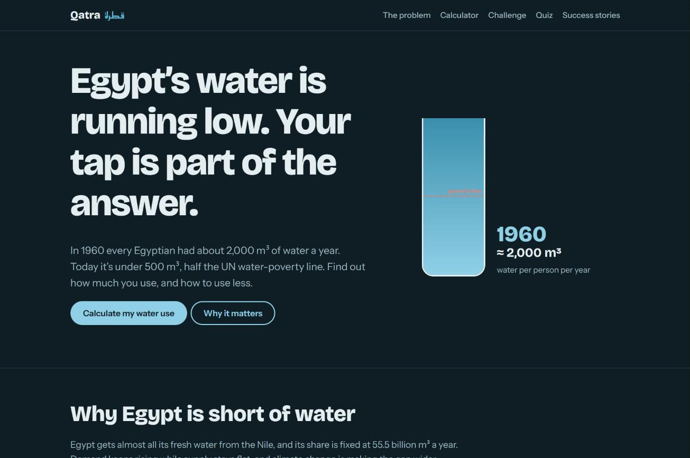

# Qatra · قطرة

**Every drop counts in Egypt.** Qatra is an interactive awareness website that helps young Egyptians measure their daily water footprint and cut it one habit at a time.

**[Live demo →](https://marwan19-saber.github.io/qatra/)**



## The problem

In 1960, every Egyptian had about 2,000 m³ of water a year. Today it is under 500 m³, which is half the UN water-poverty line. Most people never see how their own tap use adds up. Qatra makes that number personal and gives people concrete steps to reduce it.

## Features

- **Daily water-use calculator.** Ten inputs (shower length, flushes, wudu, dishwashing, laundry, car washes, dripping taps, household size and more) give an estimated litres-per-day footprint.
- **30-day Qatra challenge.** One small habit per day. Progress is saved in the browser with `localStorage`, so it survives a page reload.
- **Quiz.** Short questions that test what the visitor learned.
- **Success stories.** Cape Town avoiding "Day Zero" and Egypt's Bahr El-Baqar water treatment plant.
- **Cited sources.** Every key figure links back to published research or official reports.
- **Responsive and accessible.** Mobile breakpoint, dark-mode support and `prefers-reduced-motion` handling.

## Tech stack

| Layer | Choice |
|---|---|
| Markup & styling | HTML5, CSS3 (custom properties, responsive layout) |
| Interactivity | Vanilla JavaScript, no frameworks or build step |
| Persistence | Browser `localStorage` |
| Hosting | GitHub Pages |

## Run locally

No install needed.

```bash
git clone https://github.com/marwan19-saber/qatra.git
cd qatra
# open index.html in a browser, or serve it:
python3 -m http.server 8000   # then visit http://localhost:8000
```

## Project structure

```
qatra/
├── index.html      # the whole site: markup, styles and scripts
└── docs/
    └── screenshot.png
```

## Context

Built as a student project for **GEO217** at **Alamein International University**. It targets two UN Sustainable Development Goals:

- **SDG 6** – Clean water and sanitation
- **SDG 13** – Climate action

## Sources

- Ahram Online (2026). *Egypt's per capita water share falls below 500 cubic metres.*
- Abd El Azim, Moghazy & Moghazy (2025). *Applied Water Science*, 15, 98.
- Mabrouk et al. (2018). *Water*, 10(11), 1690.
- Visser & Brühl (2018). *Daily Maverick.*
- Arab Contractors (2021). *Bahr El-Baqar water treatment plant.*
- UN-Water (2023). *SDG 6 synthesis report.*

## Possible improvements

- [ ] Arabic language version (RTL)
- [ ] Split CSS and JS into separate files
- [ ] Add a meta description, Open Graph tags and a favicon for better sharing previews
- [ ] Share-your-result card for social media
